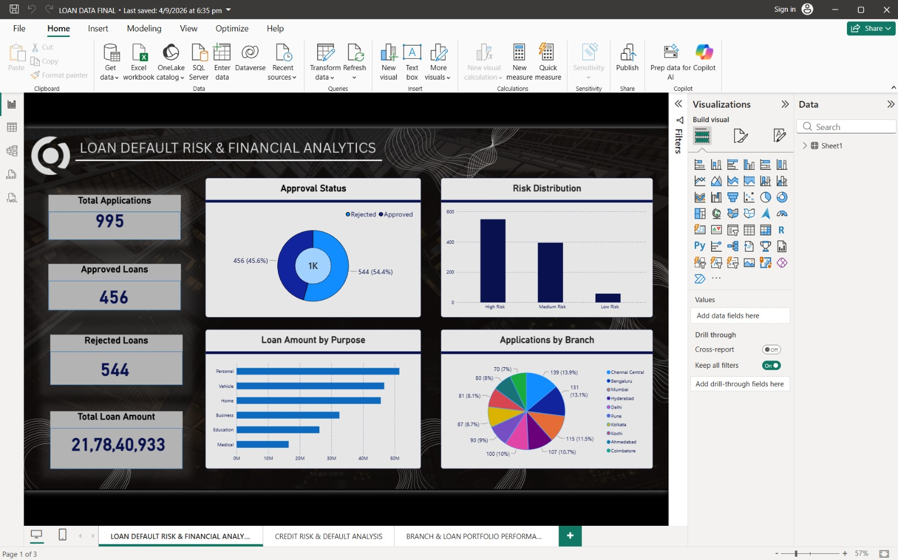
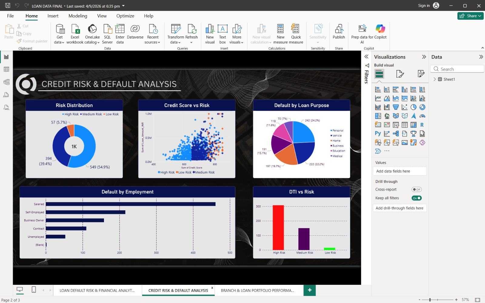
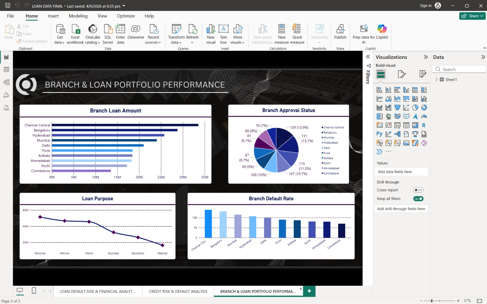
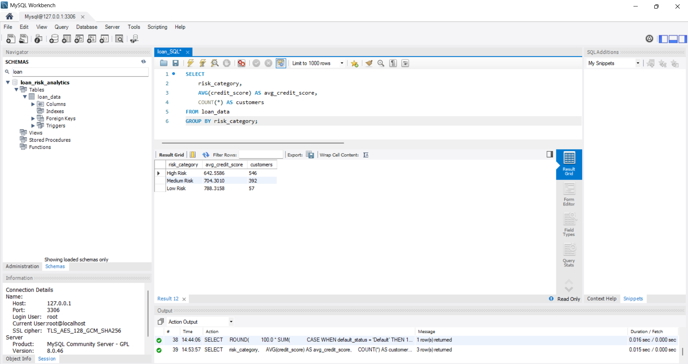
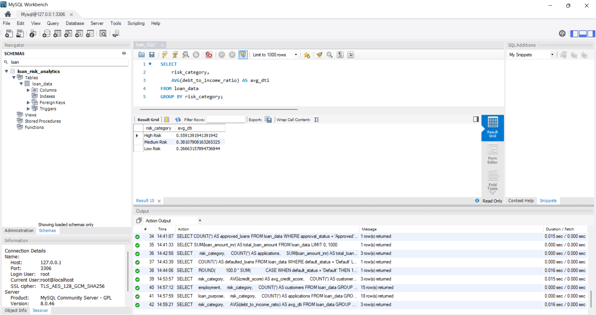
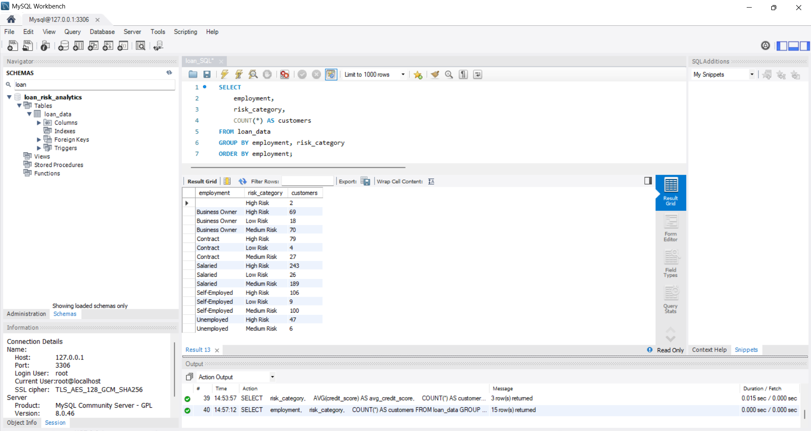
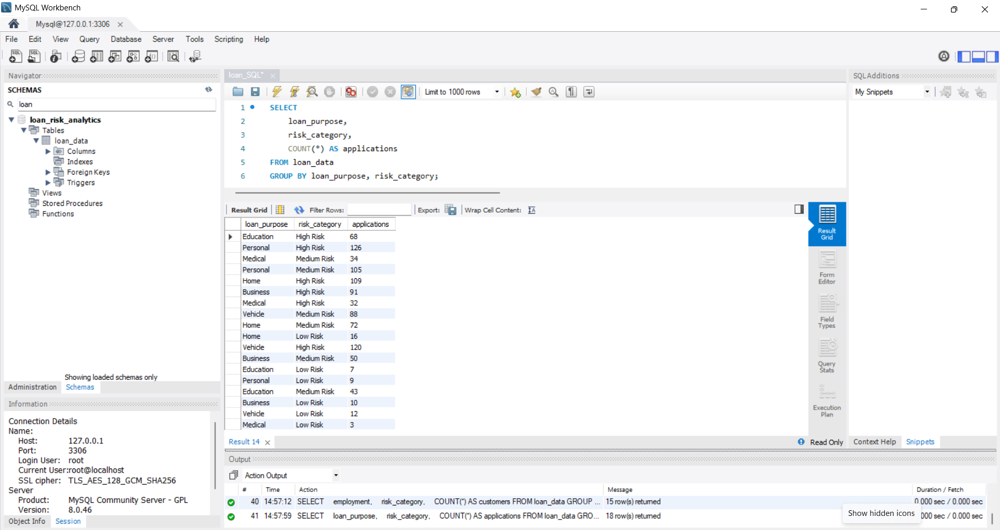
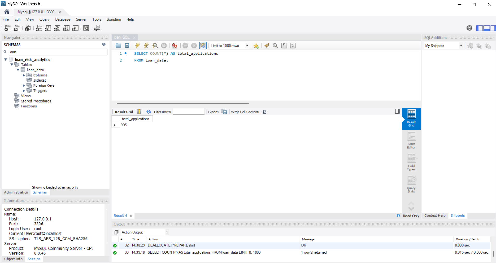
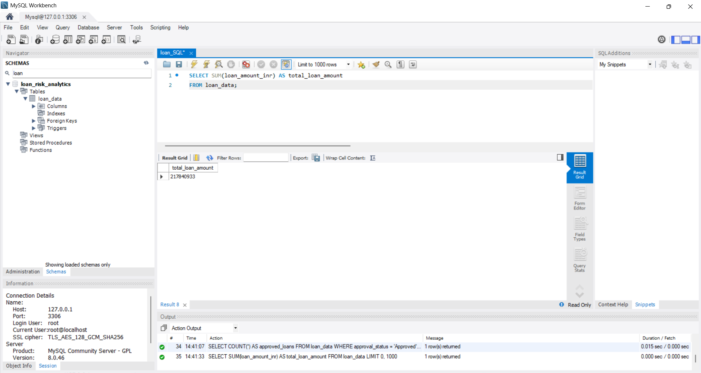

# Loan Default Risk & Financial Analytics

**Loan Application Analysis | Credit Risk | Financial Performance**

A practical data analytics project focused on exploring loan applications, approval patterns, credit risk indicators, and loan portfolio performance using Microsoft Excel and Power BI.

---

## About the Project

The purpose of this project was to explore loan application data and understand different aspects of lending performance.

I worked with the available loan datasets to examine approval and rejection patterns, compare risk categories, analyze loan amounts across different purposes, and explore application distribution across branches.

The analysis was presented through a multi-page Power BI dashboard, making it easier to review the key metrics and patterns in one place.

## Tools & Technologies

- Microsoft Excel
- Microsoft Power BI
- Power Query
- Data Cleaning and Analysis
- Data Visualization

## Dashboard Overview

The Power BI report contains three pages, each covering a different area of loan and credit risk analysis.

### 1. Loan Default Risk & Financial Analytics

Provides an overview of total applications, approval status, risk distribution, loan amounts by purpose, and branch-wise applications.



### 2. Credit Risk & Default Analysis

Explores credit risk indicators and comparisons across different borrower characteristics.



### 3. Branch & Loan Portfolio Performance

Presents branch-level application activity and loan portfolio performance.



---

## Key Analysis & Visualizations

The project covers the following areas:

- Loan approval and rejection analysis
- Risk segment distribution
- Risk vs. credit score
- Risk vs. debt-to-income ratio
- Risk vs. employment category
- Risk vs. loan purpose
- Total loan applications
- Total loan amount
- Branch-wise application distribution

### Supporting Charts

**Risk Segment Distribution**


**Risk vs. Credit Score**



**Risk vs. Debt-to-Income Ratio**



**Risk vs. Employment**



**Risk vs. Loan Purpose**



**Total Loan Applications**



**Total Loan Amount**



---

## Dataset Files

The project includes the following source files:

- [Loan Data (CSV)](Datasets/Loan_data.csv)
- [Loan Risk Data (Excel)](Datasets/LOAN%20RISK%20DATA.xlsx)
- [Loan Default Risk Analytics (Excel)](Datasets/Loan_Default_Risk_Analytics.xlsx)

## Repository Structure

```text
loan-default-risk-analysis/
│
├── Datasets/
│   ├── LOAN RISK DATA.xlsx
│   ├── Loan_data.csv
│   └── Loan_Default_Risk_Analytics.xlsx
│
├── PowerBI/
│   └── Loan_Default_Risk_Analytics.pbix
│
├── Screenshots/
│   ├── Approved_loans.png
│   ├── Default_loans.png
│   ├── Default_rate_among_approved_loans.png
│   ├── PowerBI_screenshot_1.jpeg
│   ├── PowerBI_screenshot_2.jpeg
│   ├── PowerBI_screenshot_3.jpeg
│   ├── Risk_segment.png
│   ├── Risk_vs_Credit_Score.png
│   ├── Risk_vs_DTI.png
│   ├── Risk_vs_Employment.png
│   ├── Risk_vs_loan_Purpose.png
│   ├── Total_Application.png
│   └── Total_loan_amount.png
│
├── README.md
├── LICENSE
└── .gitignore
```

## How to View the Project

1. Clone or download this repository.
2. Open the `PowerBI` folder.
3. Open `Loan_Default_Risk_Analytics.pbix` using Microsoft Power BI Desktop.
4. Explore the three dashboard pages and their visualizations.

## Key Learnings

Working on this project helped me gain practical experience in exploring financial datasets and presenting business information through dashboards.

I gained experience in:

- Understanding loan application and approval data.
- Comparing different credit risk indicators.
- Organizing financial information for analysis.
- Creating KPIs and interactive Power BI visuals.
- Presenting findings through clear and structured reports.

## Author

**Akarsh Srivastava**

Aspiring Data Analyst

- GitHub: [Akarsh78](https://github.com/Akarsh78)
- Project Repository: [Loan Default Risk Analysis](https://github.com/Akarsh78/loan-default-risk-analysis-)

---

*Developed as a practical data analytics and business intelligence portfolio project.*
